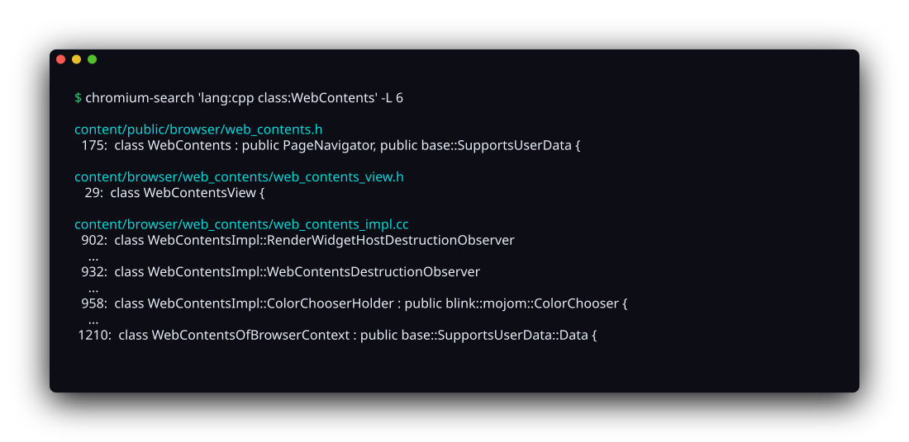

# chromium-search

An agent friendly CLI for [Chromium source code](https://source.chromium.org).

A single-file Python script with zero dependencies. Talks directly to the Chromium Code Search API.



## Install

Requires Python 3.11+ (standard library only, no other packages).

### From git (any OS, needs `git`)

Installs a real `chromium-search` command. Nothing is published to PyPI; it installs straight from this repo.

```
pip install git+https://github.com/jclay/chromium-search
```

Or, to keep it isolated from your other Python packages, use whichever tool you have:

```
pipx install git+https://github.com/jclay/chromium-search
uv tool install git+https://github.com/jclay/chromium-search
uvx --from git+https://github.com/jclay/chromium-search chromium-search <query>   # run without installing
```

Update with `pip install -U git+https://github.com/jclay/chromium-search` (or `pipx upgrade chromium-search` / `uv tool upgrade chromium-search`).

### macOS / Linux (single file)

```
curl -o chromium-search https://raw.githubusercontent.com/jclay/chromium-search/main/chromium_search.py
chmod +x chromium-search
```

Put it somewhere on your `PATH`.

### Windows without git or pip

Copy and paste into PowerShell. It installs to `%LOCALAPPDATA%\Programs\chromium-search`, adds that folder to your user `PATH`, and creates a `chromium-search.cmd` launcher so it works from PowerShell and cmd. Requires Python 3.11+ from [python.org](https://www.python.org/downloads/windows/) or the Microsoft Store (`py` or `python` on `PATH`).

```powershell
$dir = "$env:LOCALAPPDATA\Programs\chromium-search"
$raw = "https://raw.githubusercontent.com/jclay/chromium-search/main"
New-Item -ItemType Directory -Force $dir | Out-Null
foreach ($f in "chromium_search.py", "chromium-search.cmd") {
    Invoke-WebRequest -UseBasicParsing "$raw/$f" -OutFile "$dir\$f"
}
$userPath = [Environment]::GetEnvironmentVariable("Path", "User")
if (($userPath -split ";") -notcontains $dir) {
    [Environment]::SetEnvironmentVariable("Path", (($userPath, $dir) -join ";").Trim(";"), "User")
}
$env:Path += ";$dir"
chromium-search find web_contents.h
```

Open a new terminal for other windows to pick up the `PATH` change. To update, re-run the same snippet. To uninstall, delete the folder and remove it from your user `PATH`.

## Usage

```
chromium-search <query>                   # search source code
chromium-search find <name>               # find files by name
chromium-search cat <path>                # print file contents
chromium-search syntax                    # query syntax reference
```

### Search

```
chromium-search base::span
chromium-search 'lang:cpp class:WebContents'
chromium-search 'usage:TabStripModel -file:out/' -C 3
chromium-search 'file:*_test.cc base::span' -L 10
chromium-search 'function:CreateForTesting lang:cpp' --json
```

`-L <n>` limits results (default 30). `-C <n>` adds context lines. `--json` outputs JSON.

Supports filters: `lang:`, `file:`, `class:`, `function:`, `symbol:`, `usage:`, `comment:`, `case:yes`, `pcre:`. Run `chromium-search syntax` for the full reference.

### Find

```
chromium-search find web_contents.h
```

Returns file paths matching the name (fuzzy, up to 10 results).

### Cat

```
chromium-search cat content/public/browser/web_contents.h
chromium-search cat base/containers/span.h -n
chromium-search cat chrome/browser/BUILD.gn --ref refs/tags/144.0.7559.98
```

`-n` adds line numbers. `--ref` fetches at a specific git ref or tag.

## How it works

Queries the Grimoire API that powers source.chromium.org. Search and find use the batch REST transport; cat uses gRPC-Web to the FileService. No authentication required.

## License

MIT
